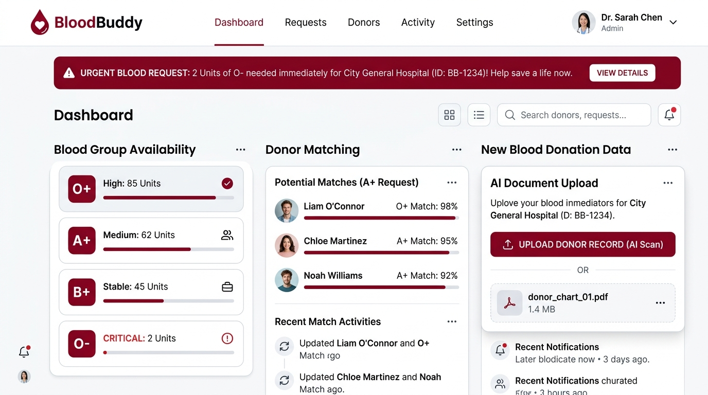

# BloodBuddy

**Every donor counts. Every connection matters.**

BloodBuddy is a community-driven blood-donor coordination platform built for Hacktoberfest Hack Day Gwalior x ITM University. It helps people organize blood donation requests, connect with willing registered donors, and coordinate safely with AI-assisted document processing and privacy-first design.



## Features

- **Blood request management**: Create requests with validation, urgency levels, and consent confirmation
- **AI document extraction**: Upload blood request documents; open-weight models extract structured fields for human review
- **Donor matching**: Same-blood-group coordination matching with approximate distance
- **Invitation workflow**: Requesters invite donors; donors accept or decline with consent-controlled contact sharing
- **Request tracking**: Full lifecycle from draft through coordination with persisted status history
- **Demo mode**: Fully functional demo with synthetic data, no external credentials required

## Architecture

```
┌─────────────────┐     ┌──────────────────┐     ┌─────────────────┐
│  React Frontend │────▶│  FastAPI Backend │────▶│  SQLite DB      │
│  (Vite + TS)    │     │  (Python)        │     │  (Persistence)  │
└─────────────────┘     └────────┬─────────┘     └─────────────────┘
                                   │
                          ┌────────▼─────────┐
                          │  AI Provider   │
                          │  demo | ollama │
                          └────────────────┘
```

### Tech Stack

| Layer | Technology |
|-------|-----------|
| Frontend | React 19, TypeScript, Vite, Tailwind CSS 4 |
| Backend | Python 3.12, FastAPI, SQLAlchemy, Pydantic |
| Database | SQLite (local dev), Firebase-ready architecture |
| AI | Provider abstraction: Demo + Ollama (Qwen2.5-VL) |
| Auth | JWT demo authentication (Firebase-ready) |
| Testing | Pytest (backend), Vitest (frontend) |
| Deployment | Docker Compose |

## Quick Start

### Prerequisites

- Python 3.12+
- Node.js 20+
- (Optional) Ollama for real AI inference

### 1. Clone and configure

```bash
git clone <repo-url>
cd bloodbuddy
cp .env.example .env
```

### 2. Start the backend

```bash
cd backend
python -m venv venv
source venv/bin/activate  # Windows: venv\Scripts\activate
pip install -r requirements.txt
mkdir -p data
uvicorn app.main:app --reload --port 8000
```

### 3. Start the frontend

```bash
cd frontend
npm install
npm run dev
```

Open **http://localhost:5173**

## Live Demo

| Service | URL |
|---------|-----|
| **Frontend (GitHub Pages)** | https://pranjalmanhgaye.github.io/bloodbuddy/ |
| **Backend API (Render)** | https://bloodbuddy-api.onrender.com |

The frontend deploys automatically to GitHub Pages on every push to `main`. The backend runs on Render (free tier; first request may take up to 60 seconds to wake up).

[](https://render.com/deploy?repo=https://github.com/PranjalManhgaye/bloodbuddy)

### Docker

```bash
docker compose up --build
```

- Frontend: http://localhost:5173
- Backend API: http://localhost:8000
- API docs: http://localhost:8000/docs

## 5-Minute Demo Flow

1. Open the landing page at http://localhost:5173
2. Click **Sign in** → select **Demo Requester (Priya Sharma)**
3. Go to **AI Document Upload** → upload `sample/sample_blood_request.txt` (rename to include "sample" in filename)
4. Review extracted fields (O+, 2 units, City General Hospital, Gwalior)
5. Confirm and create the request
6. View matching donors → invite **Rahul Verma**
7. Sign out → sign in as **Demo Donor (Rahul Verma)**
8. Accept the invitation on the donor dashboard
9. Sign back in as requester → view updated request status

### Demo Accounts

| Email | Password | Role |
|-------|----------|------|
| `requester@demo.bloodbuddy` | `demo123` | Requester |
| `donor1@demo.bloodbuddy` | `demo123` | Donor (O+) |
| `donor2@demo.bloodbuddy` | `demo123` | Donor (O+) |
| `admin@demo.bloodbuddy` | `demo123` | Admin |

## AI Integration

BloodBuddy uses a **provider abstraction** so the AI model can be swapped without rewriting the application.

### Demo Provider (default)

Deterministic extraction for hackathon demos. Activated when `AI_PROVIDER=demo`.

- Clearly labeled as "Demo Provider (deterministic, not a real model)"
- Returns structured data based on filename patterns
- No external dependencies or API keys

### Ollama Provider (real inference)

Uses **Qwen2.5-VL** for multimodal document understanding.

| Property | Value |
|----------|-------|
| Model | `qwen2.5vl:3b` (configurable) |
| License | Apache 2.0 |
| Modality | Text + Image |
| Runtime | Ollama (local) |

```bash
# Install Ollama and pull the model
ollama pull qwen2.5vl:3b

# Configure
AI_PROVIDER=ollama
OLLAMA_BASE_URL=http://localhost:11434
OLLAMA_MODEL=qwen2.5vl:3b
```

## API Endpoints

| Method | Endpoint | Description |
|--------|----------|-------------|
| GET | `/health` | Health check |
| POST | `/api/auth/demo-login` | Demo authentication |
| GET/PATCH | `/api/profile` | User profile |
| POST/GET | `/api/requests` | Blood requests |
| POST | `/api/requests/extract-document` | AI document extraction |
| GET | `/api/requests/{id}/matches` | Donor matching |
| POST | `/api/requests/{id}/invitations` | Send invitation |
| GET/PATCH | `/api/invitations` | Manage invitations |
| GET | `/api/requests/{id}/tracking` | Request lifecycle |
| POST | `/api/demo/reset` | Reset demo data (admin) |

Full interactive docs at http://localhost:8000/docs

## Testing

```bash
# Backend (21 tests)
cd backend && source venv/bin/activate
PYTHONPATH=. pytest -v

# Frontend (4 tests)
cd frontend && npm test
```

## Security & Privacy

- Synthetic demo data by default
- No public donor phone numbers or exact coordinates
- AI-extracted data requires human confirmation before use
- Contact sharing requires explicit consent
- Upload size and file type restrictions
- Prompt injection mitigation in AI extraction prompts
- Clear disclaimers: not a blood bank, hospital, or emergency service

## Limitations

- Same-blood-group matching only (not medical compatibility assessment)
- Demo authentication is not production-grade
- No real SMS/WhatsApp delivery (in-app notifications only)
- SQLite for local development (not production-scale)
- AI confidence scores are not calibrated probabilities

## License

MIT License. See [LICENSE](LICENSE).

AI model Qwen2.5-VL is licensed under Apache 2.0 by Alibaba Cloud.

## Contributors

Built for Hacktoberfest Hack Day Gwalior x ITM University. Best Open-Source AI Project challenge.
