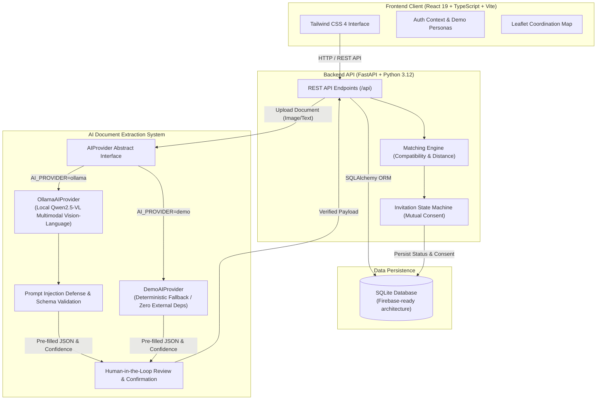

# BloodBuddy

**Every donor counts. Every connection matters.**

BloodBuddy is a community-driven blood-donor coordination platform built for Hacktoberfest Hack Day Gwalior x ITM University. It helps people organize blood donation requests, connect with willing registered donors, and coordinate safely with AI-assisted document processing and privacy-first design.


## Features

- **Blood request management**: Create requests with validation, urgency levels, and consent confirmation
- **AI document extraction**: Upload blood requisition documents; open-weight multimodal models extract structured fields with confidence scores for human verification
- **Donor matching**: Same-blood-group coordination matching with approximate distance calculation
- **Invitation workflow**: Requesters invite donors; donors accept or decline with consent-controlled contact sharing
- **Request tracking**: Full lifecycle from draft through coordination with persisted status history
- **Demo mode**: Fully functional demo with synthetic data, zero external credentials required

---

## Architecture



### Tech Stack

| Layer | Technology |
|-------|-----------|
| **Frontend** | React 19, TypeScript, Vite, Tailwind CSS 4, Radix UI (see [frontend/README.md](frontend/README.md)) |
| **Backend** | Python 3.12, FastAPI, SQLAlchemy, Pydantic |
| **Database** | SQLite (local dev), Firebase-ready architecture |
| **AI** | Provider abstraction: Demo + Ollama ([Qwen2.5-VL](https://github.com/QwenLM/Qwen2.5-VL)) |
| **Auth** | JWT demo authentication (Firebase-ready) |
| **Testing** | Pytest (backend), Vitest (frontend) |
| **Deployment** | Docker Compose |

---

## Quick Start

### Prerequisites

- Python 3.12+
- Node.js 20+
- *(Optional)* Ollama for real local AI inference (`qwen2.5vl:3b`)
- *(Optional)* Docker & Docker Compose

### 1. Clone and configure

```bash
git clone https://github.com/PranjalManhgaye/bloodbuddy.git
cd bloodbuddy
cp .env.example .env
```

### 2. Start the backend

```bash
cd backend
python -m venv venv

# macOS/Linux:
source venv/bin/activate
# Windows:
.\venv\Scripts\activate

pip install -r requirements.txt
mkdir -p data
uvicorn app.main:app --reload --port 8000
```

### 3. Start the frontend

```bash
cd frontend
npm install
npm run dev
```

Open **[http://localhost:5173](http://localhost:5173)** in your browser.

### Docker

```bash
docker compose up --build
```

- Frontend: [http://localhost:5173](http://localhost:5173)
- Backend API: [http://localhost:8000](http://localhost:8000)
- API docs: [http://localhost:8000/docs](http://localhost:8000/docs)

---

## 5-Minute Demo Flow

> **Presenter Guide:** Check out the complete, timed [5-Minute Demo Script & Talking Points](docs/DEMO_SCRIPT.md) for hackathon presentations and judge Q&A preparation.

1. Open the landing page at [http://localhost:5173](http://localhost:5173)
2. Click **Sign in** → select **Demo Requester (Priya Sharma)**
3. Go to **AI Document Upload** → upload `sample/sample_blood_request.txt`
4. Review extracted fields (O+, 2 units, City General Hospital, Gwalior) with confidence indicators
5. Confirm and create the request
6. View matching donors → invite **Rahul Verma**
7. Sign out → sign in as **Demo Donor (Rahul Verma)**
8. Accept the invitation on the donor dashboard (unlocking mutual contact sharing)
9. Sign back in as requester → view updated request lifecycle tracking

### Demo Accounts

| Email | Password | Role |
|-------|----------|------|
| `requester@demo.bloodbuddy` | `demo123` | Requester |
| `donor1@demo.bloodbuddy` | `demo123` | Donor (O+) |
| `donor2@demo.bloodbuddy` | `demo123` | Donor (O+) |
| `admin@demo.bloodbuddy` | `demo123` | Admin |

---

## AI Integration

BloodBuddy uses an **`AIProvider` abstraction** so the AI model can be swapped without rewriting any application code.

### Demo Provider (default)

Deterministic extraction for hackathon demos. Activated when `AI_PROVIDER=demo`.

- Clearly labeled in the UI as *"Demo Provider (deterministic, not a real model)"*
- Returns structured data based on sample filename patterns
- No external dependencies, GPU, or API keys required

### Ollama Provider (real inference)

Uses **Qwen2.5-VL** for multimodal document understanding.

| Property | Value |
|----------|-------|
| Model | `qwen2.5vl:3b` (configurable) |
| License | Apache 2.0 |
| Modality | Text + Image |
| Runtime | Ollama (local) |

```bash
# Install Ollama and pull the model
ollama pull qwen2.5vl:3b

# Configure in .env
AI_PROVIDER=ollama
OLLAMA_BASE_URL=http://localhost:11434
OLLAMA_MODEL=qwen2.5vl:3b
```

---

## Hacktoberfest 2026 & Contributing

BloodBuddy welcomes open-source contributions from developers of all skill levels!

- **Contribution Guidelines**: Read [CONTRIBUTING.md](CONTRIBUTING.md) for our branch naming conventions (`feature/`, `fix/`, `docs/`), PR review process, and coding standards.
- **Good First Issues**: Explore our beginner-friendly tasks on [GitHub Issues](https://github.com/PranjalManhgaye/bloodbuddy/issues?q=is%3Aissue+is%3Aopen+label%3A%22good+first+issue%22).
- **Frontend Guide**: Review [frontend/README.md](frontend/README.md) for details on UI components, styling, and testing.
- **Hackathon Track**: Built for the *Best Open-Source AI Project* challenge at Hacktoberfest Hack Day Gwalior x ITM University.

---

## API Endpoints

| Method | Endpoint | Description |
|--------|----------|-------------|
| GET | `/health` | Health check |
| POST | `/api/auth/demo-login` | Demo authentication |
| GET/PATCH | `/api/profile` | User profile |
| POST/GET | `/api/requests` | Blood requests |
| POST | `/api/requests/extract-document` | AI document extraction |
| GET | `/api/requests/{id}/matches` | Donor matching |
| POST | `/api/requests/{id}/invitations` | Send invitation |
| GET/PATCH | `/api/invitations` | Manage invitations |
| GET | `/api/requests/{id}/tracking` | Request lifecycle |
| POST | `/api/demo/reset` | Reset demo data (admin) |

Full interactive Swagger documentation is available at [http://localhost:8000/docs](http://localhost:8000/docs).

---

## Testing

```bash
# Backend (21 tests)
cd backend && source venv/bin/activate  # or .\venv\Scripts\activate on Windows
PYTHONPATH=. pytest -v

# Frontend (4 tests & linter)
cd frontend
npm test
npm run lint
npm run build
```

---

## Security & Privacy

- **Synthetic demo data**: Fictional profiles by default; no real health data stored.
- **Masked contact info**: No public donor phone numbers or exact coordinates.
- **Consent-controlled contact sharing**: Contact details are shared only after donor explicitly accepts an invite.
- **AI safety**: Prompt injection isolation in extraction templates and strict human-in-the-loop confirmation.
- **File upload limits**: Capped at 10 MB with MIME validation.
- **Medical disclaimer**: BloodBuddy is a coordination platform and not a hospital, blood bank, or emergency dispatch service.

For our full vulnerability disclosure process and detailed privacy model, see [SECURITY.md](SECURITY.md).

---

## Limitations

- Same-blood-group matching only (not clinical medical compatibility assessment)
- Demo authentication is not production-grade
- In-app notification coordination (no real SMS/WhatsApp gateway in demo)
- SQLite for local development (production requires PostgreSQL or Firebase)
- AI confidence scores are categorized heuristic confidence tags

---

## License

MIT License. See [LICENSE](LICENSE).

AI model Qwen2.5-VL is licensed under Apache 2.0 by Alibaba Cloud.

---

## Contributors

Built with ❤️ for Hacktoberfest Hack Day Gwalior x ITM University.
